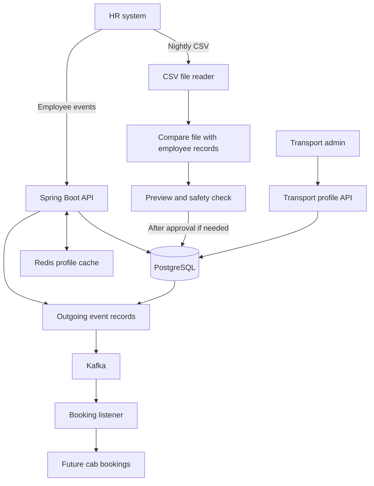
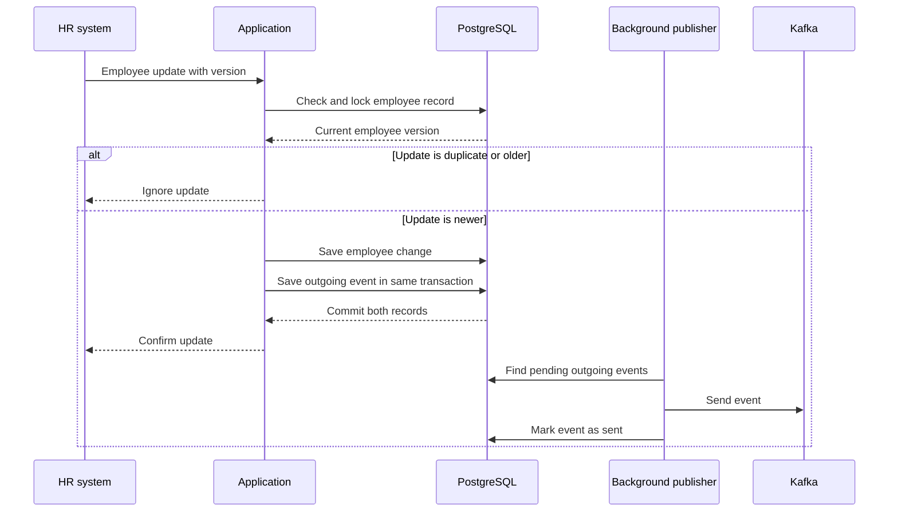

# Design Note – HR Roster Sync

## 1. What problem does this project solve?

MoveInSync receives employee information from corporate clients. The information may arrive more than once, arrive in the wrong order, contain invalid values, or arrive as an incomplete nightly file.

This project keeps the employee records correct in those situations. It also makes sure that HR updates do not overwrite information managed by the transport team.

The design follows the main requirements in **Case Study 5: HR Roster Sync – Idempotent, Out-of-Order, Self-Healing**.

## 2. Main parts of the system

- **HR system:** Sends employee changes through an API or provides a nightly CSV file.
- **Spring Boot application:** Checks incoming data and applies valid changes.
- **PostgreSQL:** Stores employee records, file-comparison results and outgoing event records.
- **Redis:** Keeps a short-lived copy of employee profiles to make reads faster.
- **Kafka:** Carries employee-change events to other services.
- **Booking listener:** Responds to deactivation events by cancelling future confirmed cab bookings and freeing the reserved seat.
- **Transport API:** Lets transport admins update pickup point and special-assistance details.

## 3. Handling duplicate and out-of-order updates

Every employee update has a version supplied by the source system. The application compares the incoming version with the version already stored for that employee.

For example, if version 7 has already been saved:

| Incoming version | What the application does |
|---|---|
| 7 | Ignores it because it is a duplicate |
| 6 | Ignores it because it is older |
| 8 | Applies it because it is newer |

The application uses the tenant ID, employee ID and source version to identify repeated updates. Database locks protect updates for the same employee when requests arrive at the same time, including when the employee is being created for the first time.

This directly addresses the case-study example where version 7 arrives before version 6: version 6 must not undo the newer information.

## 4. Keeping HR and transport information separate

The case study says that HR owns the employee's name, email, manager and office, while transport admins own pickup point and special-assistance needs.

This project follows that split:

| HR can change | Transport admin can change |
|---|---|
| Name | Pickup point |
| Email | Special-assistance needs |
| Manager | |
| Office | |
| Phone and active status | |

An HR update changes only HR-owned fields. The transport fields stay as they were. This prevents an HR file from accidentally removing transport preferences.

## 5. Nightly file comparison

The nightly CSV is compared with the employee records already stored in PostgreSQL. The comparison creates three groups:

| Group | Meaning | Result when applied |
|---|---|---|
| New | In the file, not in the database | Create an employee |
| Changed | In both places, but an HR-owned field changed | Update the HR-owned fields |
| Missing | Active in the database, not in the file | Mark the employee inactive |

The application first creates a **preview**. The preview saves the proposed changes in staging tables but does not change live employee records.

### How large files are processed

The case study asks for a comparison of up to 200,000 employees without loading the entire CSV and database list into memory.

This project processes the data in smaller pieces:

1. Read the CSV gradually, handling quoted values, commas inside quotes, escaped quotes and line breaks inside quoted values.
2. Put each CSV record into one of 256 temporary disk files based on its employee ID.
3. Read employee records from PostgreSQL gradually and put them into matching temporary files.
4. Compare one matching pair of files at a time.
5. Save the new, changed and missing records in the database staging tables.
6. Remove the temporary files after processing.

This reduces the amount of data that normally needs to be in memory at once.

**Memory trade-off:** When employee IDs are spread reasonably evenly across the 256 groups, each comparison handles only a portion of the data. If many IDs end up in one group, that group can become large. Therefore, the design reduces expected memory use but does not guarantee a fixed maximum for every possible input.

## 6. Safety brake: protect against an incomplete file

A nightly export may be cut short. If the application treated every missing employee as someone who had left, it could deactivate many employees by mistake.

The application calculates:

`missing ratio = missing active employees / active employees before comparison`

The threshold is configurable and defaults to 30%.

- If fewer than 30% of active employees are missing, the run is marked ready to apply.
- If 30% or more are missing, the run is put on hold and requires operator approval.
- An attempt to apply a run before the required approval is rejected.

This means a suspicious file does not automatically deactivate employees. An operator can inspect the preview and decide whether the file is correct before approving the changes.

## 7. Hardest flow: applying changes and publishing events

The application must update the employee record and make sure that other services are told about the change. It uses an outgoing event record, often called an **outbox**, for this.

The employee change and its outgoing event record are saved in the same database transaction. If that transaction fails, neither is saved. A background publisher sends pending events to Kafka.

Kafka delivery is **at least once**, not exactly once. If Kafka receives an event but the application stops before marking it as sent, the event may be sent again after recovery. Each event has a unique ID, and receiving services should use it to recognise duplicates.

The publisher uses database row locking with `SKIP LOCKED` so multiple application instances can share pending work without selecting the same locked rows.

## 8. Protecting the apply operation

Two requests might try to apply the same CSV preview at nearly the same time. The application locks the reconciliation run in the database before applying it.

The run moves through these states:

`READY_TO_APPLY / APPROVED → APPLYING → APPLIED`

Only a run that is ready or approved can be applied. A second request cannot apply a run that is already applied. Employee changes, version increases and outgoing event records are part of the same transaction. If the transaction fails, the database rolls back those changes.

New employees start at version 1. Updating or deactivating an existing employee increases its version.

## 9. Deactivation and cab bookings

When an employee is deactivated, the application creates an outgoing event. The Kafka booking listener uses that event to cancel the employee's future confirmed cab bookings and release the reserved seat.

The booking update is safe to receive more than once: a booking that is already cancelled is not cancelled again.

## 10. Failure cases and recovery

| What can go wrong? | What the system does | Recovery or protection |
|---|---|---|
| Same update arrives again | Ignores it as a duplicate | No second employee change |
| Older update arrives late | Ignores it as stale | Newer employee data stays saved |
| A record has invalid data | Rejects that record | Other valid batch records can still be processed |
| A user tries to access another tenant | Rejects the request | Tenant is checked against the authenticated user |
| Database is unavailable | The request fails | The source can retry the same version |
| Kafka is unavailable | Outgoing event stays pending | Publisher retries later |
| Application stops after saving an employee change | Outgoing event remains in PostgreSQL | Publisher can send it after restart |
| Kafka receives an event but the sent status is not saved | Event may be delivered again | Consumer should recognise the unique event ID |
| Nightly file is missing 30% or more of active employees | Run waits for approval | Operator checks the file before applying |
| Two requests apply the same run | Database lock allows only a valid apply | Repeat apply is rejected |

## 11. Trade-offs and current limits

- **Correct ordering vs. write availability:** Updates for the same employee are protected with database locks. This helps keep the employee record correct, but requests for that employee may have to wait. Different employees can still be processed at the same time.
- **Reliable event recording vs. immediate delivery:** The employee update is saved even if Kafka is temporarily unavailable. The event is delivered later, so other services may see the change after a short delay.
- **Disk use vs. memory use:** Temporary disk files help avoid loading the full snapshot into memory. This adds disk reading and writing, and an uneven bucket distribution can increase memory use for one comparison.
- **Cache freshness:** Employee profiles are cached in Redis for up to two minutes. Successful HR and transport writes evict the relevant cache entry. If an eviction is missed, the cached value can remain stale until its time-to-live expires. PostgreSQL remains the source of truth.
- **Demo authentication:** The assessment uses in-memory HTTP Basic demo accounts. A real deployment should use company single sign-on and persistent access control.
- **Outbox retention:** Published event rows are retained. A production deployment should add a cleanup or archive process.
- **Performance evidence:** The recorded 200,000-row benchmark uses mocked database access and measures the file-processing algorithm. A separate PostgreSQL integration benchmark uses 5,000 rows. A full 200,000-row database-backed benchmark is still needed before claiming that the complete flow meets the case-study target of under 60 seconds.
- **Failure testing:** Retry and recovery behavior is tested. A full test that kills the process at the exact point between the database commit and Kafka publication would provide stronger evidence for the case-study crash requirement.

## 12. Main rules the implementation protects

1. A tenant can access only its own employee records.
2. An older or repeated source version cannot overwrite a newer employee record.
3. HR updates do not change transport-owned fields.
4. Employee changes and their outgoing event records are saved together.
5. Deactivation increases the employee version.
6. A suspicious nightly file cannot deactivate employees without approval.
7. A reconciliation run cannot be applied twice.
8. Personal employee details should not appear in logs or public error messages.
