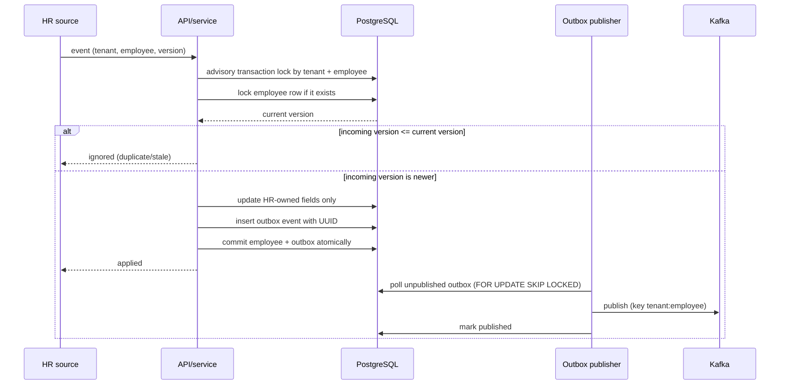
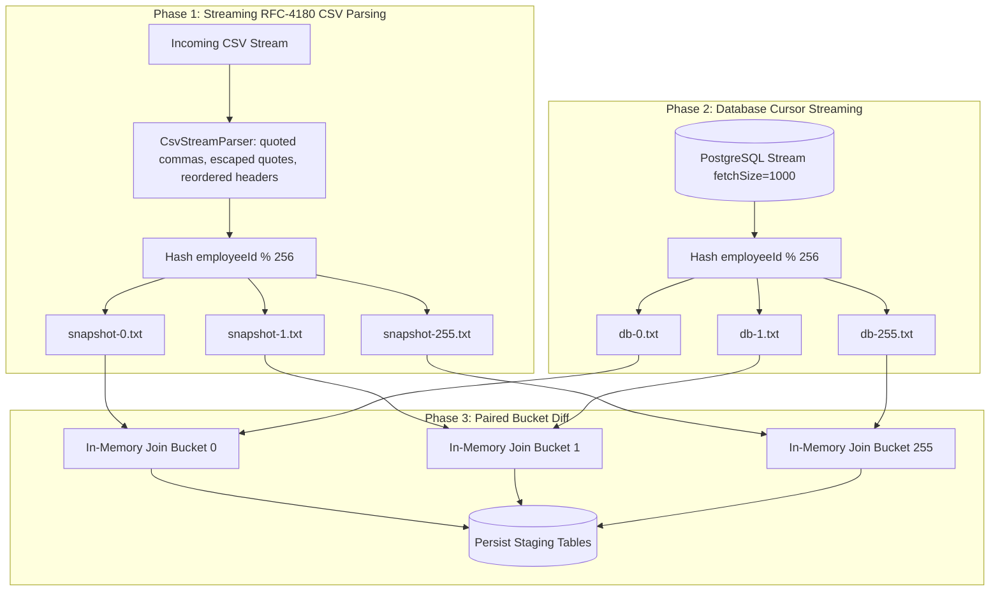

# Design Note — HR Roster Sync

## Architecture

```mermaid
flowchart LR
  HR[HR API / Nightly CSV] --> API[Spring Boot API]
  API --> V[Boundary validation]
  V --> S[EmployeeSyncService]
  S --> DB[(PostgreSQL employees)]
  S --> OB[(Transactional outbox)]
  OB --> PUB[Outbox publisher: FOR UPDATE SKIP LOCKED]
  PUB --> K[(Kafka employee-changes)]
  K --> BOOK[Booking cancellation consumer]
  BOOK --> CAB[(Cab bookings / seat reservation)]
  TA[Transport Admin] --> TP[Transport profile API]
  TP --> DB
  CSV[Nightly snapshot CSV] --> PARSE[RFC-4180 streaming CSV parser]
  PARSE --> REC[256-bucket streaming partitioner]
  REC --> DIFF[Bucket-by-bucket 3-way diff]
  DIFF --> STAGE[(Staging: reconciliation_new, reconciliation_changed, reconciliation_missing)]
  DIFF --> BRAKE{Missing threshold >= 30%?}
  BRAKE -->|Yes| HOLD[Awaiting operator approval]
  BRAKE -->|No| PLAN[Ready to apply]
  HOLD --> APPROVE[Operator approval: /{runId}/approve]
  APPROVE --> APPLY[Concurrency-safe apply: /{runId}/apply]
  PLAN --> APPLY
  APPLY --> DB
  APPLY --> OB
```

## Hardest flow: ordering and atomic outbox



## Three-Way Reconciliation Architecture

The nightly reconciliation compares an incoming HR snapshot against the existing database to compute a complete three-way diff:

### 1. The Three Diff Categories

1. **New Employees (`reconciliation_new`)**:
   - Present in incoming HR snapshot, absent in database.
   - At apply time: inserted as new records with `active = true`, `source_version = 1`, and outbox event `EMPLOYEE_CHANGED (SNAPSHOT_CREATED)`.
2. **Changed Employees (`reconciliation_changed`)**:
   - Present in both snapshot and database.
   - One or more HR-owned fields differ: `name`, `email`, `manager_id`, `office_code`, or previously inactive.
   - Transport-owned fields (`pickup_point`, `special_assistance`) are completely ignored during comparison.
   - At apply time: updated with new HR fields, version incremented (`source_version = source_version + 1`), transport fields preserved intact, and outbox event `EMPLOYEE_CHANGED (SNAPSHOT_UPDATED)`.
3. **Missing Active Employees (`reconciliation_missing`)**:
   - Present as active in database, absent in snapshot.
   - Subject to the 30% safety brake calculation.
   - At apply time: deactivated (`active = false`), version incremented (`source_version = source_version + 1`), and outbox event `EMPLOYEE_DEACTIVATED (SNAPSHOT_DEACTIVATED)`.

### 2. Streaming RFC-4180 CSV Parsing & Bounded-Memory Algorithm (256 Disk Buckets)

Loading 200,000 employee records into memory causes excessive heap pressure and risk of `OutOfMemoryError`. To maintain bounded working memory:



- **Phase 1 (CSV Partitioning):** A dedicated streaming RFC-4180 parser reads the input stream character-by-character. It handles quoted fields with commas, escaped quotes (`""`), multi-line quoted fields, reordered headers, and missing optional fields. Each valid record is partitioned by `(employeeId.hashCode() & 0x7fffffff) % 256` into 256 temporary disk bucket files (`snapshot-{b}.txt`). Malformed rows are recorded in `invalidRows`.
- **Phase 2 (Database Partitioning):** Stream database records via Hibernate cursor (`fetchSize = 1000`), hash into 256 database disk bucket files (`db-{b}.txt`).
- **Phase 3 (Bucket-by-Bucket Comparison):** For bucket `b = 0..255`:
  1. Load only `snapshot-{b}.txt` into an in-memory `LinkedHashMap<String, SnapshotRow>`.
  2. Duplicate employee IDs in the CSV hash to the same bucket file and are detected and flagged in `invalidRows`.
  3. Stream `db-{b}.txt` sequentially:
     - If DB record is not in snapshot bucket $\rightarrow$ if active, record as **missing**.
     - If DB record is in snapshot bucket $\rightarrow$ compare HR fields. If changed, record as **changed**. Remove key from snapshot map.
  4. Any remaining records in the map were in the snapshot but not in DB $\rightarrow$ record as **new**.
  5. Persist diff batch to staging tables `reconciliation_missing`, `reconciliation_changed`, `reconciliation_new`.
  6. Clear memory map and proceed to bucket `b + 1`. Temporary files are removed immediately after diffing.
- **Complexity Analysis:**
  - **Time Complexity:** $O(N)$ streaming reads + $O(N)$ hashing + $O(N)$ bucket joins + $O(M)$ batch writes.
  - **Memory Complexity:** Under uniform hash distribution, expected working heap memory is $O(N / 256)$ ($\approx 781$ records per bucket for 200,000 employees, $\approx 150 \text{ KB}$ heap usage per bucket). In the worst-case adversarial scenario where all identifiers produce the identical hash code, bucket size degrades to $O(N)$.

### 3. Safety Brake and Human-in-the-Loop Workflow

- Missing employee ratio: `missingRatio = missingCount / activeBefore`.
- Safety brake threshold: `missingRatio >= 0.30` (30%).
- If brake trips:
  - Run status set to `AWAITING_APPROVAL`, `safetyBrake = true`.
  - Calling `POST /api/v1/reconciliation/{runId}/apply` without approval fails with `HTTP 409 Conflict`.
  - Operator must inspect preview details and invoke `POST /api/v1/reconciliation/{runId}/approve`.
  - Once `APPROVED`, the operator invokes `POST /api/v1/reconciliation/{runId}/apply` to execute the changes.

### 4. Concurrency-Safe Atomic Apply

- To prevent race conditions from concurrent apply requests:
  1. A pessimistic lock is acquired on the reconciliation run row: `SELECT status FROM reconciliation_runs WHERE id=? AND tenant_id=? FOR UPDATE`.
  2. Only runs with status `READY_TO_APPLY` or `APPROVED` can be applied; if status is already `APPLIED`, the request is rejected with `RUN_ALREADY_APPLIED` (HTTP 409 Conflict).
  3. The status is atomically transitioned to `APPLYING`.
  4. Deactivations (with version increment), HR field updates (with version increment), and new employee insertions execute alongside transactional outbox generation within the single database transaction.
  5. Upon completion, the status transitions to `APPLIED`.
  6. Any runtime failure triggers an immediate transaction rollback, reverting the status transition and all staged mutations.

## Invariants

1. `(tenant_id, employee_id)` identifies exactly one employee.
2. Only a strictly greater HR source version can change HR-owned employee state.
3. HR updates and reconciliation apply never write transport-owned columns (`pickup_point`, `special_assistance`).
4. Employee mutation and outbox insertion share one database transaction.
5. Missing-employee deactivation increments `source_version` and includes the incremented version in the outbox payload.
6. A suspicious snapshot never deactivates employees automatically.
7. Tenant scope comes from the authenticated principal; the caller-supplied tenant header must match it.
8. Logs and public errors contain identifiers/codes only, never phone, email, name or pickup location.

## Failure-mode table

| Failure | User/operator sees | Recovery |
|---|---|---|
| Duplicate event | `IGNORED / DUPLICATE_VERSION` | no write; safe replay |
| Stale event | `IGNORED / STALE_VERSION` | newer state remains |
| Invalid phone / office / fields | generic validation code | reject only that batch record; correct at source |
| Tenant header does not match principal | HTTP 403 | authenticate as a member of the correct tenant |
| DB unavailable | request fails; no success acknowledgment | retry with same event/version |
| Process dies after DB commit | event remains pending in outbox | publisher resumes after restart |
| Kafka unavailable | outbox remains pending; publish attempt is retried by later poll | monitor backlog; restore broker |
| Kafka accepted but outbox mark fails | possible duplicate message | consumer uses event UUID; booking update is idempotent |
| Snapshot is missing >= threshold | `AWAITING_APPROVAL` (safety brake) | investigate export; approve the persisted run before apply |
| Unapproved apply attempt | HTTP 409 Conflict | must approve run first via `/{runId}/approve` |
| Concurrent or duplicate apply | HTTP 409 Conflict (`RUN_ALREADY_APPLIED`) | safe rejection; no duplicate modifications or outbox records |
| Booking cancellation fails | Kafka listener retries according to container error handling | restore booking DB and allow redelivery |

## Consistency, availability and latency trade-offs

- Per-employee ordering favors consistency over write availability: transaction-scoped advisory locks serialize same-employee events, including first-time creates.
- Different employees can be processed concurrently.
- The API commits employee state and outbox before acknowledging success; Kafka availability does not block the HR write, but downstream propagation is eventual.
- At-least-once Kafka publication is chosen over an unsupported exactly-once claim. Consumers should deduplicate using immutable `eventId`.
- Multi-replica outbox polling uses `SELECT FOR UPDATE SKIP LOCKED` to prevent duplicate polling across instances.
- Employee profile cache is Redis-backed with a two-minute TTL and explicit tenant-key eviction after successful writes; Redis is never authoritative.
- Snapshot safety favors preventing false deactivations over immediate reconciliation. The implementation persists the preview, new, changed, and missing IDs in staging tables; a safety-brake run requires operator approval before the transactional apply step.
- Hash partitioning trades temporary disk I/O for bounded working memory. Expected memory is $O(N/256)$.
